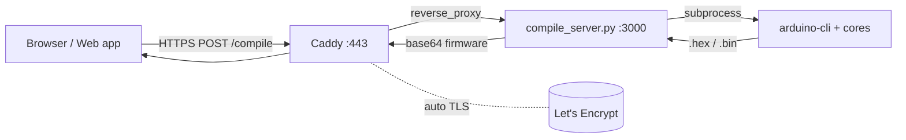

# Arduino / ESP Cloud Compile Service

A small, production-grade HTTP service that compiles Arduino / ESP8266 / ESP32
sketches in the cloud and returns ready-to-flash firmware — designed to replace
slow CI-based compilation (e.g. GitHub Actions `repository_dispatch`) with a
**warm, low-latency endpoint that responds in seconds**.

This repository documents how to stand the same service up on **three clouds** —
**Oracle Cloud (Always Free)**, **AWS**, and **Azure** — using nothing but the
cloud CLI, a single portable provisioning script, and optionally Docker. It is
both a working service and a reference for cross-cloud Linux/DevOps setup.

> Built to power a browser-based circuit simulator's "compile & flash to real
> hardware" feature, but it's generic: anything that needs `arduino-cli` behind
> an HTTPS API can use it.

---

## Why this exists

The original design compiled sketches through **GitHub Actions**: the web app
dispatched a `repository_dispatch` event, a runner spun up, installed the board
cores, compiled, uploaded an artifact, and the client polled for the result.

That works, but it is the wrong tool for an interactive feature:

| | GitHub Actions | This service |
|---|---|---|
| Cold-start / dispatch overhead | 30–60 s every call | none (always warm) |
| Core install | per run (mins) unless cached | baked in once |
| Transport | dispatch → poll → download artifact | one HTTP request → response |
| Typical ESP8266 compile (warm) | minutes + overhead → frequent timeouts | **~11 s** |
| Cost | Actions minutes | **\$0** on a free-tier VM |

Warm compile times measured on an Oracle AMD micro (1 vCPU-equivalent, 1 GB RAM
+ swap):

| Board | Warm | Cold (first build of a variant) |
|---|---|---|
| Arduino Uno (AVR) | ~3 s | ~6 s |
| ESP8266 (NodeMCU) | ~11 s | ~125 s |
| ESP32 (Dev Module) | ~24 s | ~98 s |

The cold build only happens once per board variant; `arduino-cli`'s build cache
makes every subsequent compile fast.

---

## Architecture



- **Caddy** terminates TLS (automatic Let's Encrypt certificates) and reverse-
  proxies to the app. Adds CORS for browser clients.
- **`compile_server.py`** — a dependency-free Python stdlib HTTP server. Accepts
  a sketch, runs `arduino-cli`, and returns the firmware as base64. Parses AVR
  Intel HEX to a raw binary so every board returns ready-to-flash bytes.
- **`arduino-cli` + cores** (`arduino:avr`, `esp8266:esp8266`, `esp32:esp32`)
  are pre-installed, so there is no per-request toolchain download.

### Security & robustness
- **Token auth** on `/compile` (`COMPILE_TOKEN`).
- **Per-IP rate limiting** (default 20 req / 60 s, reads `X-Forwarded-For`).
- **Global concurrency cap** (default 2) so concurrent ESP32 link steps can't
  exhaust RAM on a small box.
- **Compile timeout**, payload-size cap, and quiet logging.
- TLS-only in production via Caddy.

---

## API

`POST /compile`

```json
{ "code": "void setup(){}\nvoid loop(){}", "board": "uno|esp32|esp8266", "token": "..." }
```

Response:

```json
{ "status": "done", "format": "hex|bin", "data": "<base64 firmware>" }
```

Errors return `{ "status": "error", "message": "..." }` with an appropriate HTTP
status (`400` bad request, `401` unauthorized, `413` too large, `429` rate-
limited / busy, `504` compile timeout).

`GET /health` → `{ "ok": true }`

Board → FQBN mapping (in `server/compile_server.py`):

| `board` | FQBN | Notes |
|---|---|---|
| `uno` | `arduino:avr:uno` | returns Intel HEX (parsed to binary) |
| `esp8266` | `esp8266:esp8266:nodemcuv2` | NodeMCU — defines `D0–D8`, `LED_BUILTIN` |
| `esp32` | `esp32:esp32:esp32` | raw GPIO numbers; no `LED_BUILTIN` |

---

## Deploy

Two paths — pick one:

### A. Native (what the free-tier guides use)
One portable script installs swap, `arduino-cli`, the cores, the systemd
service, and Caddy on a fresh Ubuntu box:

```bash
sudo COMPILE_TOKEN=$(openssl rand -hex 24) DOMAIN=compile.example.com \
  bash deploy/common/provision.sh
```

### B. Docker
```bash
COMPILE_TOKEN=$(openssl rand -hex 24) DOMAIN=compile.example.com \
  docker compose up -d --build
```

### Per-cloud provisioning (CLI-driven, free tier)
Each folder has a `01-create-instance.sh` that creates the smallest free-tier VM
and opens ports 80/443, then you run the provision script:

- [`deploy/oracle/`](deploy/oracle/) — Oracle Cloud **Always Free** (ARM Ampere A1 / AMD micro)
- [`deploy/aws/`](deploy/aws/) — AWS EC2 (`t4g.small` free trial / `t2.micro`)
- [`deploy/azure/`](deploy/azure/) — Azure VM (`Standard_B1s` 12-month free)

### Run it locally / fully offline

For classrooms with no internet, run the **same** server on the local machine so
a (service-worker-cached) PWA can compile against `http://localhost:3000` with no
cloud at all — Linux, macOS, **and Windows**. See [`local/`](local/).

```bash
bash local/install.sh                       # Linux / macOS
powershell -File local\install.ps1          # Windows (PowerShell + winget)
```

### Cloud free-tier comparison

| | Oracle Always Free | AWS Free | Azure Free |
|---|---|---|---|
| Instance | ARM A1 (4 vCPU/24 GB) **or** AMD micro (1 GB) | `t2.micro`/`t4g.small` 750 h/mo (12 mo) | `B1s` 750 h/mo (12 mo) |
| Duration | **Forever** | 12 months | 12 months |
| Firewall layers | OS + **VCN Security List** | OS + **Security Group** | OS + **NSG** |
| Gotcha | ARM capacity errors; reclaims idle VMs | free tier expires | free tier expires |
| Best for | permanent \$0 host | familiar tooling | Microsoft stack |

> All three need ports **80 + 443** opened at **both** the OS firewall *and* the
> cloud network layer — the most common "it works on SSH but not HTTPS" trap.

---

## Troubleshooting

### "Could not reach the bootloader" — ESP uploads work, AVR (Uno/Nano) refused
This is a **client-side flashing** symptom, not a compile-server fault — the
server returns correct ready-to-flash bytes for AVR (Intel HEX → binary) and
ESP (raw `.bin`) alike. ESP flashing uses `esptool-js` (which owns its own serial
reads), while AVR flashing speaks STK500v1 over Web Serial in the client.

The bug (fixed 2026-06-23): the client's Web Serial reader raced
`reader.read()` against a timeout that **abandoned** the pending read. The next
read issued a second, overlapping `read()`, so the bootloader's `STK_INSYNC /
STK_OK` sync reply was delivered to the abandoned read and silently dropped — the
Uno *was* answering, the client just never saw it. Every AVR upload then looked
like "no bootloader".

Fix (in the browser client's `webserial.ts`):
- A **single background read pump** fills a rolling byte buffer; the protocol
  polls that buffer — no overlapping `read()` calls.
- A proper **auto-reset pulse** (assert DTR/RTS → release) tried two ways:
  classic **DTR+RTS** and **DTR-only** (some CH340 clones mishandle RTS).
- A **complete STK500v1 handshake**: `ENTER_PROGMODE` → per-page
  `LOAD_ADDRESS` + `PROG_PAGE` (each acknowledged) → `LEAVE_PROGMODE`, with the
  serial monitor always restored afterward.

If a particular **CH340 clone** still won't auto-reset (some lack the reset
capacitor), press the board's **RESET** button just as you click Upload.

See [`CHANGELOG.md`](CHANGELOG.md).

---

## Repository layout

```
.
├── server/              # the compile server + Dockerfile
├── caddy/               # TLS reverse-proxy config
├── systemd/             # service unit + keep-alive timer
├── deploy/
│   ├── common/          # provision.sh — cloud-agnostic box setup
│   ├── oracle/          # OCI CLI instance creation + notes
│   ├── aws/             # AWS CLI instance creation + cloud-init
│   └── azure/           # Azure CLI instance creation + cloud-init
├── docker-compose.yml
└── .github/workflows/   # shellcheck + python lint CI
```

## License

[MIT](LICENSE) © Lottie Mukuka
